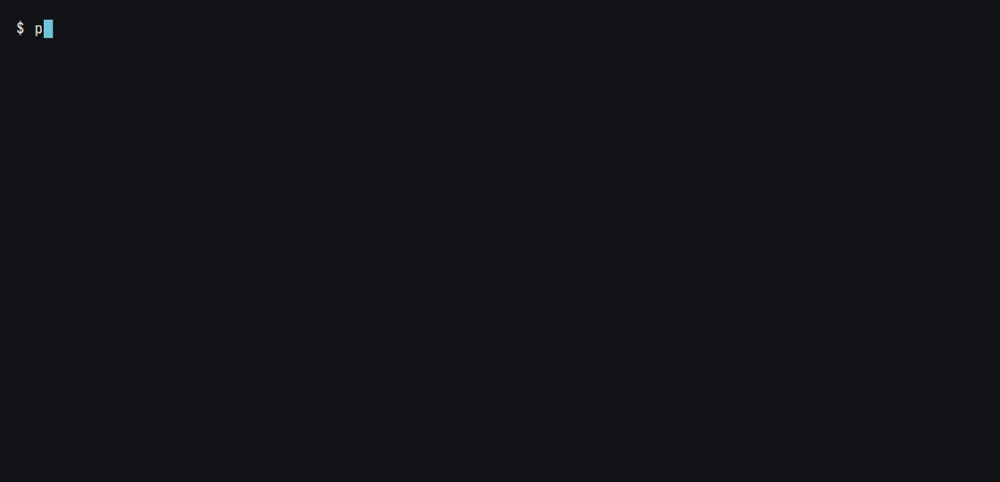
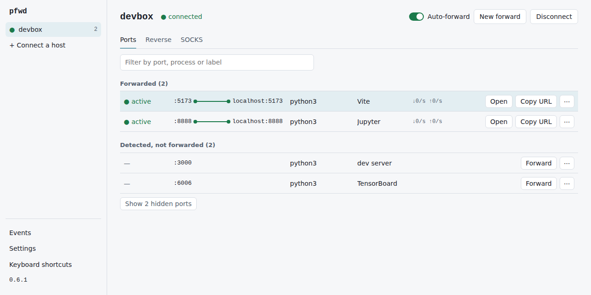

<h1>
  <picture>
    <source media="(prefers-color-scheme: dark)" srcset="assets/logo/pfwd-horizontal-dark.svg">
    
  </picture>
</h1>

The VS Code Ports panel for any terminal. Agentless, one binary, every OS.

[](https://github.com/hoanghero125/pfwd/actions/workflows/ci.yml)
[](https://github.com/hoanghero125/pfwd/releases)
[](https://goreportcard.com/report/github.com/hoanghero125/pfwd)
[](LICENSE)

`pfwd devbox` connects to a host from your `~/.ssh/config` and shows a live table of the TCP ports listening on it. Start `npm run dev` on the server and, a few seconds later, `localhost:5173` on your laptop reaches it. You don't press anything.



> **Status: v0.6.0, early.** The TUI, scripting commands, a background daemon and a web UI work; expect rough edges until v1.0.

## Install

| Where | Command |
| --- | --- |
| macOS, Linux (Homebrew) | `brew install hoanghero125/tap/pfwd` |
| Windows (Scoop) | `scoop bucket add pfwd https://github.com/hoanghero125/scoop-bucket` then `scoop install pfwd/pfwd` |
| Debian, Ubuntu, Fedora, Alpine | `.deb`, `.rpm` and `.apk` packages on the [releases page](https://github.com/hoanghero125/pfwd/releases) |
| Any OS with Go 1.26+ | `go install github.com/hoanghero125/pfwd/cmd/pfwd@latest` |

Release archives come with a `checksums.txt` signed by cosign (keyless, from the release workflow) and an SBOM. To build from a clone you need git and GNU make: `make build`. On Windows, run make from Git Bash; [CONTRIBUTING.md](CONTRIBUTING.md) has the setup.

## Quick start

```sh
pfwd devbox            # an alias from ~/.ssh/config
pfwd alice@10.0.0.5    # or user@host, like ssh
pfwd devbox -p 2222 -i ~/.ssh/id_work -F ./ssh_config
pfwd devbox -J bastion # through a jump host, like ssh -J
pfwd devbox gpu-node   # several hosts, a tab each
```

The first time you connect to a server, pfwd shows its host key fingerprint and asks before saving it to `known_hosts`, the way `ssh` does. Then the table fills in:

```
  pfwd  devbox ● connected                                   auto: on   ? help

  devbox                                                this computer
▌ :5173   Vite        ○─•───• ↓ 12K/s  ↑ 1.0K/s •───•─● localhost:5173 http
  :8000   —           ○╌╌╌╌╌ paused, port closed ╌╌╌╌╌● localhost:8000
  :8888   Jupyter     ○──────────── idle ─────────────● localhost:8888 http pin

  on devbox, not forwarded
  :6379   Redis       ○╌╌╌
  :9090   Prometheus  ○╌╌╌

  1 ignored hidden, h shows
  ✓ Forwarded :5173 to localhost:5173
  enter stop  o open  y copy  p pin  a auto  / filter  L log  ? help  q quit
```

Each forward is a tunnel from the server's port (`○`) to the one on your machine (`●`). A working tunnel is a solid line, and dots move along it while traffic flows. A paused or failed one is a broken line that says why.

| Key | Does |
| --- | --- |
| `↑` `↓` `j` `k`, `g` `G` | move, first, last |
| `enter` or `f` | forward the port to the same local port, or stop the forward |
| `F` | forward to a different local port |
| `x` | stop the forward |
| `o` | open the forward in your browser (`https://` when the server speaks TLS) |
| `y` | copy its URL |
| `p` | pin the forward, so it comes back the next time you connect |
| `a` | turn auto-forward on or off for this host |
| `/` | filter rows by port, process or label; `esc` clears the filter |
| `h` | show or hide ignored ports |
| `L` | event log |
| `r` | list this machine's ports, to expose one on the server |
| `d` | start or stop a SOCKS proxy on port 1080 |
| `c` | reconnect now |
| `tab`, `shift+tab` | next or previous host, with several open |
| `ctrl+a` | every host in one table, with a HOST column; keys act on the selected row's host |
| `+` | connect another host from your ssh config |
| `?` | help |
| `q` or `ctrl+c` | quit (asks first while forwards are active) |

If the local port is taken, pfwd offers the next free one instead. With `ui.mouse` on (the default), a click selects a row and the wheel scrolls.

## Auto-forward

A port that starts listening while pfwd is connected gets forwarded to the same local port, with no key press, once two snapshots in a row have seen it. A desktop notification tells you, unless you set `ui.notifications = false`. Ports that were already listening when pfwd connected stay in the table, unforwarded, until you press `enter`.

Some ports are never auto-forwarded and are hidden from the table: port 22 and processes such as `sshd`, `systemd-resolved` and `containerd`. The view line under the table counts them; `h` shows them. `detect.ignore_ports` and `detect.ignore_processes` replace these lists, so keep `22` and `sshd` in yours if you still want ssh hidden; `forward.auto_ports` limits auto-forward to the ports you name.

A port you stop with `x` stays stopped for the rest of the session, and so does one whose auto-forward failed. Press `enter` on it to forward it by hand. Turn auto-forward off for a host with `a`, for one run with `--no-auto`, or for good with `forward.auto = false`.

Each new forward is probed once, through the SSH connection, to see whether it speaks HTTP or HTTPS. The LABEL column shows the result next to the service name. Database ports (Postgres, MySQL, Redis, MongoDB) are not probed.

## Dropped connections

pfwd checks the connection every 15 seconds (`ssh.keepalive_interval`, or `ServerAliveInterval` from your ssh config) and reconnects on its own when it drops. A connection the network closes is noticed at once; one that dies silently, after three unanswered checks (`ssh.keepalive_count_max`), so within about a minute. It waits 0.5 s before the first attempt, then 1 s, 2 s and so on, up to 30 s between attempts, until the host is back. The forwards pause in the meantime but keep their local ports, so `localhost:5173` works again as soon as the connection does; a request made during the gap waits up to 10 seconds for it.

The top bar counts down to the next attempt. `c` tries right away, and `x` stops trying until you press `c`. A rejected login or a changed host key stops the retries, since trying again wouldn't help.

A forward whose server stops listening pauses too, and resumes when the port is back. An auto-forward that stays paused for 10 minutes (`forward.auto_expire`) is removed, unless you pinned it.

## Pinned forwards

`p` pins the selected forward. pfwd keeps its forwards in `state.json`, next to its log. While it runs it saves all of them, so they come back after a crash; when you quit it keeps only the pinned ones. The next time you connect to that host, they come back on the same local ports, before any new port is detected. `forward.restore = false` turns this off.

Forwards listed under `[hosts.<alias>]` in the config file are always on, like pinned ones, and show `cfg` instead of `pin`. So are the `LocalForward`, `RemoteForward` and `DynamicForward` lines of your ssh config for that host. pfwd skips Unix-socket forwards and notes each one it skips in its log.

## Remote forwards and SOCKS

`r` lists the ports listening on the machine running pfwd. `enter` exposes the selected one on the server under the same port number, and `F` under another. The row shows `rev`, and a program on the server reaches your port at `localhost:<port>`. The server's sshd has to allow it (`AllowTcpForwarding yes`, the default); to listen on an address other than loopback there, it also needs `GatewayPorts`. In the config, `"-R 9000:3000"` exposes local port 3000 as port 9000 on the server. After a dropped connection, the server can hold the port for the old session a while longer; the row says `port busy` and pfwd keeps asking until the port is free. `ClientAliveInterval` in the server's sshd_config shortens that wait.

`d` starts a SOCKS5 proxy on `localhost:1080` that makes its connections from the server, so a browser set to use it reaches what the server reaches. `d` again stops it. In the config, it is `"-D 1080"`. A SOCKS proxy only listens on loopback: on any other address, anyone on your network could reach everything the server can. `forward.allow_lan_socks = true` or `--allow-lan-socks` allows it anyway.

On Linux, a local port below 1024, such as 80, needs root. When pfwd isn't allowed to listen on one, it uses that port plus 10000 instead (`localhost:10080`), and the LOCAL column shows the port it used. `forward.privileged_offset` changes the 10000; 0 turns this off.

## Scripting

`pfwd ls`, `pfwd fwd`, `pfwd stop`, `pfwd hosts`, `pfwd doctor` and the `daemon` commands work without a terminal (the TUI and `pfwd attach` need one). Results go to stdout, errors to stderr with a suggested fix, and `--json` prints JSON instead of text.

```sh
pfwd ls devbox                  # the ports listening on devbox, once
pfwd ls devbox --json
pfwd fwd devbox 5432 8080:3000  # forward until Ctrl+C, reconnecting when the connection drops
pfwd fwd devbox -R 9000 -D 1080
```

`pfwd fwd` takes ssh's `-L` syntax (`PORT`, `LOCAL:PORT`, `LOCAL:HOST:PORT`, `BIND:LOCAL:HOST:PORT`), plus `-R PORT[:LOCAL]` and `-D PORT`, each repeatable. It creates only what you name: no remembered or configured forwards, and no auto-forward unless you pass `--auto`. A taken local port follows `forward.on_conflict`, with `ask` acting as `next`.

With `--json`, `pfwd fwd` prints one JSON object per line: `{"event": "forward", "forward": {...}}` when a forward starts or changes state, and `{"event": "session", "host", "state", "error"}` when the connection drops or comes back.

`pfwd ls --json` prints `{"hosts": [{"host", "state", "os", "ports": [...], "forwards": [...]}]}`. Each port has `port`, `addrs`, `process`, `pid`, `label` and `ignored`. Each forward has `id`, `host`, `kind` (`local`, `remote` or `dynamic`), `bind`, `local`, `remote_host`, `remote`, `state`, `pause`, `error`, `pinned`, `auto`, `config`, `label`, `scheme`, `mapped_from`, `conns`, `bytes_in`, `bytes_out` and `started_at`. For a `remote` forward, `bind` and `remote` are on the server and `remote_host` and `local` on this machine. `pfwd hosts --json` lists `{"host", "last_used", "forwards"}` (`last_used` is null for a host never used), and `pfwd stop --json` prints `{"stopped": [ids]}`.

An unknown host key or a passphrase is asked on the terminal. Without one, the command stops with the fix: run `pfwd <host>` or `ssh <host>` once, pass `--accept-new`, or add the key to ssh-agent.

| Exit code | Meaning |
| --- | --- |
| 0 | OK |
| 1 | Another error |
| 2 | Bad usage: an unknown flag, a missing argument |
| 3 | The host could not be reached |
| 4 | Authentication failed |
| 5 | The host key changed, or an unknown one could not be confirmed |
| 6 | A forward could not listen, here or on the server |
| 130 | Interrupted with Ctrl+C |

## Background daemon

`pfwd fwd --detach` hands forwards to a background daemon, starting it when none runs, and returns once they listen. The daemon keeps them up, reconnecting as the TUI does, after the terminal closes:

```sh
pfwd fwd devbox 5432 8080:3000 --detach
pfwd ls                     # every host the daemon serves, with its ports and forwards
pfwd stop devbox:5432       # by host and local (or server) port; or by the ID pfwd ls --json shows
pfwd stop --all devbox
pfwd attach                 # the TUI on the daemon's hosts; q detaches and leaves the forwards running
pfwd daemon status          # exit code 1 when none runs
pfwd daemon stop            # ends the daemon and its forwards
```

`pfwd daemon start` starts it on its own; `pfwd daemon start -F file` gives it another ssh config. It listens on a Unix socket only you can open (in `$XDG_RUNTIME_DIR`, else your own directory under the system temp directory), or on Windows a named pipe only you can open; `PFWD_SOCKET` names another. The daemon logs to `pfwd.log`.

The daemon works like the TUI: it follows `config.toml`, so auto-forward is on unless the config turns it off (`--auto` or `--no-auto` on `pfwd fwd --detach` sets it for that host), and it restores pinned and configured forwards. It reads hosts from your ssh config, so `pfwd fwd --detach` refuses `-p`, `-l`, `-i`, `-J` and `-F`: put them in `~/.ssh/config`. `--bind` sets the address of the forwards you name. When the daemon needs a host-key confirmation or a passphrase, `pfwd fwd --detach` asks on your terminal, or with `--accept-new` trusts a new host key.

## Web UI

`pfwd ui` opens the same controls in a browser tab:

```sh
pfwd ui                     # starts the daemon if none runs, and opens the browser
pfwd ui devbox gpu-node     # connects these hosts first
pfwd ui --no-open           # prints the login link instead of opening it
pfwd ui --url               # prints only the link, for scripts
```

<picture>
  <source media="(prefers-color-scheme: dark)" srcset="demo/web-dark.png">
  
</picture>

The web UI is a front end of the daemon, like `pfwd attach`, so the browser, the TUI and the CLI show the same forwards. Closing the tab leaves them running; `pfwd daemon stop` ends them and the web UI.

Each host has its forwarded and detected ports, with Forward, Open and Copy URL on every row and a menu to pin, label, see the details (state history, connections, traffic over the last five minutes) or stop. Reverse forwards and the SOCKS proxy have their own tabs. There is an event log, and a settings page: a form for the common keys, or the whole `config.toml`. Nothing is saved until the daemon has checked the file, and the daemon uses saved settings after a restart. Host-key questions, passphrases and passwords show up in the page. The keys follow the TUI: `j`/`k`, `Enter`, `o`, `y`, `x`, `p`, `a`, `/` and `?`.

The web UI listens on 127.0.0.1 only, on a random port; `--port` picks the port when the daemon starts the web UI. A login link works once, for ten minutes, and every `pfwd ui` makes a new one: run it again to open the web UI in another tab or browser. The link sets a session cookie and hands the page a token that every request must also carry. The page keeps the token in its tab, so another program listening on 127.0.0.1 can't use the cookie. Requests from other sites, or with another `Host`, are refused, and the page loads nothing from the internet. `pfwd daemon status` shows the web UI's address.

The daemon reads hosts from your ssh config and follows `config.toml`, so `pfwd ui` refuses `-l`, `-i`, `-J`, `-F`, `--auto`, `--no-auto`, `--bind` and `--accept-new`. Switch auto-forward per host in the page, and answer host-key questions there.

## When something doesn't work

`pfwd doctor devbox` checks each step in order and says how to fix the first one that fails: how the ssh config resolves the host, whether it answers, its host key, the login, port detection, `-L` and `-R` forwarding on the server, and listening on this machine. It never writes `known_hosts`: with `StrictHostKeyChecking accept-new` or `--accept-new`, it trusts a new key for the check only and says so. Its exit code is 3, 4 or 5 when the connection, the login or the host key fails, as for the other commands.

`pfwd doctor --bundle devbox` also writes `pfwd-doctor-<time>.zip` for a bug report: the version, your config file, how many forwards are remembered per host, the end of the log, and the report. Secrets and your home directory are taken out, but look inside before you attach it.

## Hosts and shell completion

`pfwd hosts` lists the hosts in your ssh config, and the ones you have used pfwd with, most recent first (`--json` for scripts). Tab completion offers the same names:

```sh
pfwd completion bash > ~/.local/share/bash-completion/completions/pfwd
pfwd completion zsh > "${fpath[1]}/_pfwd"
pfwd completion fish > ~/.config/fish/completions/pfwd.fish
pfwd completion powershell | Out-String | Invoke-Expression   # add this line to $PROFILE to keep it
```

## Configuration

pfwd works without a config file. To change its defaults, run `pfwd config edit`: it creates the file with every setting at its default, commented, and opens it in `$VISUAL`, `$EDITOR`, or notepad on Windows and vi elsewhere. `pfwd config validate` checks the file and points at the line and column of anything it doesn't accept; pfwd refuses to start with a broken config, so you never get silent defaults.

The file lives at `~/.config/pfwd/config.toml` on Linux, `~/Library/Application Support/pfwd/config.toml` on macOS and `%AppData%\pfwd\config.toml` on Windows. `pfwd config path` prints it. `PFWD_CONFIG` or `--config` points pfwd at another file. [docs/config.md](docs/config.md) describes every setting.

```toml
[detect]
interval = "2s"            # how often to list the server's ports
ignore_ports = [22]        # ports or ranges like "9000-9100"

[forward]
auto = true                # forward new ports automatically
auto_ports = []            # if not empty, only auto-forward these, e.g. ["3000-3999", 5173]
bind = "127.0.0.1"         # 0.0.0.0 exposes forwards to your network
on_conflict = "ask"        # when a local port is taken: ask, next, random or fail

[ui]
theme = "auto"             # auto, dark or light
notifications = true       # desktop notification when a port is auto-forwarded

[labels]
8000 = "API"

[hosts.devbox]             # overrides for one host, by ssh config alias
auto = false
forwards = ["5432", "15432:db.internal:5432", "-R 9000:3000", "-D 1080"]   # always on
```

These flags override the file for one run: `--auto` and `--no-auto`, `--bind`, `--interval`, `--allow-lan-socks` and `--no-color`. pfwd also honors `NO_COLOR`, and draws ASCII instead of Unicode symbols in the old Windows console (`ui.glyphs` changes that).

## How it works

pfwd resolves the host with `ssh -G`, so `Match`, `Include` and every default work exactly as they do for `ssh`; without OpenSSH it reads `~/.ssh/config` itself. It follows `ProxyJump` and `ProxyCommand`, checks `known_hosts` for every hop, and always refuses a changed host key.

It logs in with ssh-agent (on Windows, the OpenSSH agent or Pageant) and your `IdentityFile` keys, and asks in the terminal for what the server wants beyond that: the passphrase of an encrypted key, a password, or a one-time code. Passphrases, and passwords the server asks for with SSH's password method, stay in memory for the session, so a reconnect doesn't ask again. Answers to keyboard-interactive prompts, which is how servers ask for one-time codes (and some for passwords), are asked for every time. Nothing typed is written to disk or to the log.

Nothing gets installed on the server. pfwd runs one probe to learn the server's OS, then a small loop on a single SSH channel that lists the listening sockets every 2 seconds: with `ss` on Linux, or by reading `/proc/net/tcp` on busybox systems; with `lsof` on macOS; with `sockstat` on FreeBSD and `netstat` on the other BSDs; and with `netstat` and `tasklist` in PowerShell on Windows servers running OpenSSH. It writes no files there and uploads no binary.

Forwards listen on `127.0.0.1` unless you change `forward.bind` or pass `--bind`, so your network can't reach them. When they listen on another address, the top bar says so.

Logs go to `pfwd.log` in pfwd's state directory: `~/.local/state/pfwd` on Linux, `~/Library/Application Support/pfwd` on macOS, `%APPDATA%\pfwd` on Windows. Set `--log-level debug` or `PFWD_LOG=debug` for more detail.

## Not supported yet

- Unix-socket forwards, and a SOCKS proxy on the server side (`ssh -R` with only a port).

## Why pfwd

- It needs no agent on the server, so it works on locked-down, shared and university machines where you can't upload anything.
- It is one static Go binary for Linux, macOS and Windows, and doesn't need OpenSSH at runtime.
- Scripts get the same engine as the TUI: `pfwd fwd` keeps forwards up through dropped connections, and `pfwd ls --json` lists what a server listens on.

## Documentation

[docs/](docs/README.md) has the install options (with checking a download), common jobs step by step, every setting, troubleshooting and a FAQ.

## Contributing

See [CONTRIBUTING.md](CONTRIBUTING.md). Report security problems privately as described in [SECURITY.md](SECURITY.md).

## License

[MIT](LICENSE)
